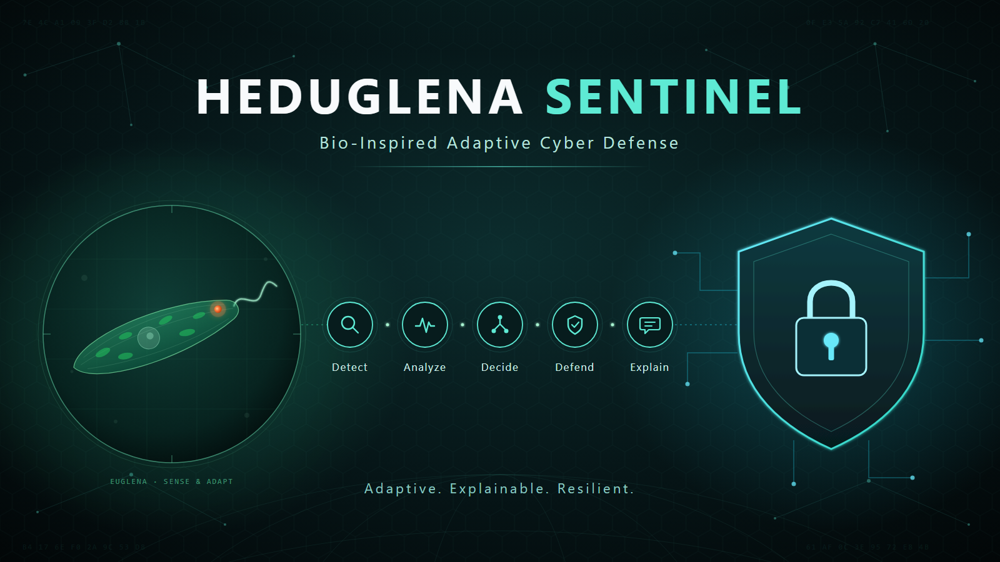
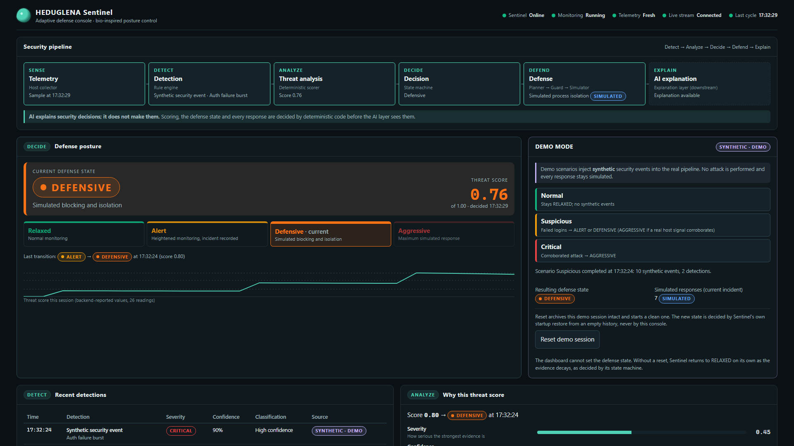

# HEDUGLENA Sentinel



> An adaptive cyber-defense prototype inspired by *Euglena*, a single-cell organism that
> senses its environment and repositions itself. Sentinel senses host telemetry, decides how
> dangerous it is, shifts its defense posture, and explains each decision.

**Hackathon:** Kiroween 2026  
**Status:** working hackathon prototype, not a production security product. Every response
action is **simulated**: nothing on the host is blocked, isolated, killed or deleted.

## What it does

```
DETECT → ANALYZE → DECIDE → DEFEND → EXPLAIN
```

1. **Detect.** Real host telemetry (CPU, memory, disk, network, process count) is collected
   with `psutil` and checked by rule-based detectors. Controlled **synthetic** security events
   (failed logins, access denials, connection bursts, a simulated malicious process) enter
   through the same detection intake for demonstrations.
2. **Analyze.** A deterministic scorer turns evidence into a threat score from 0 to 1. Its
   contributions are severity, confidence, repetition, escalation, correlation and cross-domain
   evidence, with time decay.
3. **Decide.** A defense state machine moves between **RELAXED**, **ALERT**, **DEFENSIVE** and
   **AGGRESSIVE**. It climbs one level at a time after a dwell period and descends slowly, with
   severity floors and a corroboration requirement for AGGRESSIVE.
4. **Defend.** The ResponsePlanner recommends actions for the state. The ResponseGuard
   authorizes each one, and the SimulatedActionExecutor records what it *would* have done:
   alert, increase monitoring, record incident, and simulated IP block, process isolation and
   quarantine. Every action is stored with an audit trail and labeled SIMULATED.
5. **Explain.** After the decision is made and stored, an explanation layer describes it in
   plain English. By default this is a **deterministic, offline template** (`AI_PROVIDER=null`).
   An LLM can be configured, but it is **explanation-only**: its output passes a strict
   validator and can never change a score, state or action.

The dashboard shows the whole sequence live: system status, the pipeline, the defense posture,
detections, the score breakdown, guarded responses, the incident timeline and the explanation.

## Quick start (local development)

**Tested with:** Python 3.14.2, Node.js 24.12, npm 11.6 on Windows 11. `pyproject.toml` declares
Python ≥ 3.11, but 3.11–3.13 have not been tested.

```bash
# Terminal 1 — backend (http://127.0.0.1:8000, API docs at /docs)
cd backend
python -m venv .venv
.venv\Scripts\activate          # Windows;  source .venv/bin/activate on macOS/Linux
pip install -e ".[dev]"
cp ../.env.example .env         # optional; the backend reads .env from backend/
uvicorn app.main:app --host 127.0.0.1 --port 8000

# Terminal 2 — dashboard (http://localhost:3000, proxies /api, /health and /ws to :8000)
cd frontend
npm install
npm run dev
```

**On first start**, the backend:
1. creates the SQLite database (`backend/sentinel.db`) through the Alembic migrations;
2. restores the last defense state;
3. starts monitoring real host telemetry.

A database that exists but is not at the current migration is refused, never migrated
automatically. Back it up, then run `python -m alembic upgrade head` in `backend/`.

**Production build of the dashboard**, with the production security headers:
`npm run build && npm run verify:csp && npm run preview`.

**Docker is not working yet.** `docker-compose.yml` uses a `curl` health check, but the backend
image has no `curl`, so the frontend container never starts. Use the local steps above.

## Running the demo

Open the dashboard. The **DEMO MODE** panel, next to the defense posture, offers three
scenarios. Each starts only when you click it, and each injects only synthetic events, labeled
**SYNTHETIC · DEMO**:

| Scenario | Synthetic events | What the dashboard shows |
|---|---|---|
| **Normal** | none | Real host telemetry only. RELAXED unless the host itself is under pressure |
| **Suspicious** | 10 failed logins | Detection, a rising score, simulated responses, an incident and its explanation. Suspicious normally reaches ALERT or DEFENSIVE. It may reach AGGRESSIVE when a real host signal corroborates the synthetic attack |
| **Critical** | 10 failed logins + a simulated malicious process | Corroborated evidence, AGGRESSIVE, simulated quarantine, the full incident timeline and its explanation |

**Reset demo session** (with a confirmation step) starts a clean session; see
[Demo reset](#demo-reset). Without a reset, the posture relaxes on its own as evidence decays,
which takes several minutes.

The same operations are available over HTTP, all answering 403 when `DEMO_MODE=false`:
- `GET /api/v1/demo/scenarios`
- `POST /api/v1/demo/scenario/{normal|suspicious|critical}`
- `POST /api/v1/demo/inject`
- `POST /api/v1/demo/reset`

**Note:** real host telemetry stays real during the demo. On a machine with high memory use
(above the 90% memory rule), a real memory-pressure detection can appear during any scenario.
It is shown as **REAL HOST**, never as a demo event. During "Suspicious" it counts as a second,
independent signal, which is why that scenario can then reach AGGRESSIVE.

### Screenshot



A real capture of the running dashboard (1920×1080), not a mockup. It was taken during the
**Suspicious** scenario, in the **DEFENSIVE** state with a threat score of about 0.76, using
the default offline explanation provider (`AI_PROVIDER=null`). All responses shown are
simulated. The [full-page capture](docs/assets/dashboard-defensive-full.png) shows every panel.

## API overview

All routes are listed at `http://127.0.0.1:8000/docs`.

| Purpose | Routes |
|---|---|
| Health and runtime | `GET /health`, `/api/v1/status`, `/api/v1/runtime` |
| Current readings | `GET /api/v1/state/current`, `/api/v1/score/current`, `/api/v1/telemetry/latest` |
| Recent records | `GET /api/v1/events`, `/api/v1/actions`, `/api/v1/incidents` |
| One incident | `GET /api/v1/incidents/{SIT-n}`, `/api/v1/ai/explain/{SIT-n}` |
| AI status | `GET /api/v1/ai/status` |
| Demo | `/api/v1/demo/*`, see above |
| Live stream | `WS /ws/live` |

Read routes answer 503 while the runtime is starting or a reset is in progress.

`WS /ws/live` is **receive-only**:
- **Content:** sanitized telemetry, detection, score, state-change and response messages.
- **Client input:** ignored.
- **Origin:** a browser origin other than `FRONTEND_ORIGIN` is refused.
- **Reconnect:** when the runtime restarts (for example after a demo reset), the server closes
  the socket with code 1012 and the dashboard reconnects. While the stream is down, the
  dashboard polls every 2 s.

Not built yet: the history endpoints (score, state and telemetry history), the detection-rule
API and its dashboard panel.

## Demo reset

`POST /api/v1/demo/reset` (or **Reset demo session** in the DEMO MODE panel, which asks for
confirmation) returns the demo to a clean starting condition **without deciding anything**:

- It is refused unless `DEMO_MODE=true` and the database is a local SQLite file, and it takes
  **no input at all**: a body or query string is answered 422, so a client can never choose a
  defense state, a threat score or an incident.
- It stops the running session (demo scenario, monitoring loop and explanation worker are
  cancelled and awaited; live dashboards are told to reconnect).
- It **archives** the session's database file, intact, by renaming it to
  `<database>-demo-sessions/session-<UTC time>/`. Nothing is deleted or rewritten.
- It starts a new session exactly as application startup does: the schema comes from the
  Alembic migrations and the defense state from the state machine's own restore, which finds
  an empty history and therefore reports RELAXED.

It never sets a state or a score, writes no transition or response, and calls nothing in the
scorer, state machine, ResponsePlanner, ResponseGuard or simulator. Real host telemetry keeps
being collected by the new session; demo events stay `source="demo"`, `is_synthetic=true`.
Archived sessions accumulate until you remove them.

## Content Security Policy

The production build is served with this policy (single source: `frontend/config/csp.ts`):

```
default-src 'none'; script-src 'self'; style-src 'self'; img-src 'self'; font-src 'self';
connect-src 'self'; manifest-src 'self'; base-uri 'none'; form-action 'none';
object-src 'none'; frame-ancestors 'none'
```

No `unsafe-eval`, no `unsafe-inline`. `connect-src 'self'` covers the API and the same-origin
`/ws/live` WebSocket. A frontend cannot set its own HTTP headers, so the policy is delivered in
three ways:

| Where | How |
|---|---|
| Any static host | `<meta http-equiv="Content-Security-Policy">` injected into `dist/index.html` at build time (cannot carry `frame-ancestors`) |
| `serve -s dist` (used by the frontend Dockerfile) | `dist/serve.json`, emitted by the build, sets the full header plus `X-Content-Type-Options`, `Referrer-Policy`, `X-Frame-Options`, `Permissions-Policy`, `Cross-Origin-Opener-Policy` |
| `npm run preview` | the same headers (verified in a browser: 0 CSP violations) |

**Other deployments must set the header themselves.** Serve the dashboard and the backend from
one origin (a reverse proxy routing `/api`, `/health` and `/ws` to the backend). If the API is on a
different origin, build with `VITE_API_BASE_URL=https://api.example` and
`VITE_WS_URL=wss://api.example`; those exact origins are added to `connect-src`, and an invalid
value fails the build. For nginx, for example:

```nginx
add_header Content-Security-Policy "<the policy above>" always;
add_header X-Content-Type-Options nosniff always;
add_header X-Frame-Options DENY always;
add_header Referrer-Policy no-referrer always;
```

`npm run build && npm run verify:csp` checks the build: no inline script, style or event handler,
the meta policy present, and the header policy free of unsafe sources.

## Running tests and checks

```bash
# Backend (from backend/)
pytest                                   # all tests: unit, integration, security
pytest tests/security                    # security boundaries only
pytest --cov=app --cov=api --cov=core --cov=detection --cov=telemetry --cov=threat \
       --cov=response --cov=ai --cov=explanation --cov=evaluation --cov=database --cov=models
ruff check .
mypy --strict app api core detection telemetry threat response ai explanation evaluation database models
bandit -r . -x ./tests -ll

# Frontend (from frontend/)
npm run typecheck && npm run lint && npm run test
npm run build && npm run verify:csp
```

**Last verified results (2026-11-23):**

| Check | Result |
|---|---|
| Backend tests | 2,114 passed |
| Backend coverage (source packages) | 97% |
| `mypy --strict` | clean on 98 source files |
| Bandit | 0 issues |
| Ruff | 9 pre-existing findings, all in Phase 1 Alembic files and one test |
| Frontend tests | 60 passed |
| `tsc --noEmit` | clean |
| ESLint | 0 warnings |
| CSP check | passes |

**Not yet in place:**
- end-to-end (Playwright) tests
- performance tests
- frontend coverage measurement
- unit-test-only coverage is below the 80% target (task 36 in `tasks.md`)

## Project structure

```
heduglena_Sentinel/
├── backend/
│   ├── app/            # FastAPI app (main.py), runtime orchestrator (runtime.py),
│   │                   # session lifecycle and demo reset
│   ├── api/v1/         # Thin route handlers: runtime, incidents, demo, live WebSocket
│   ├── core/           # Settings, demo scenarios, live hub, public read models
│   ├── telemetry/      # Host telemetry collection and validation
│   ├── detection/      # Detection engine and rules (resource, process, network, synthetic)
│   ├── threat/         # Threat scorer, defense state machine, decisions, situations
│   ├── response/       # ResponsePlanner, ResponseGuard, SimulatedActionExecutor
│   ├── ai/             # LLM provider port, adapters, AIOutputValidator
│   ├── explanation/    # Explanation service and context builder (downstream only)
│   ├── evaluation/     # Offline LLM evaluation harness (never imported by the app)
│   ├── database/       # SQLAlchemy models, repositories, schema bootstrap
│   ├── alembic/        # Migrations
│   └── tests/          # unit, integration, security
├── frontend/
│   ├── src/            # app, features (one per pipeline stage), components, hooks,
│   │                   # services (REST + WebSocket clients), styles, types (API contract)
│   ├── config/         # Content Security Policy
│   └── tests/          # Vitest + Testing Library, incl. a real-backend contract fixture
├── .kiro/              # specs, steering, hooks (Kiro project configuration)
├── docs/               # readiness audit, visual QA checklist, evaluation decisions
├── scripts/            # hook checks, contract-fixture exporter
├── docker-compose.yml  # not working yet (see Quick start)
└── .env.example
```

## Architecture and security boundaries

The authoritative design is
[`.kiro/specs/heduglena-sentinel/design.md`](.kiro/specs/heduglena-sentinel/design.md).

- **One decision path.** Every defense-state change and every recorded response goes
  through the pipeline: telemetry → detection → threat scoring → state machine → decision →
  ResponsePlanner → ResponseGuard → SimulatedActionExecutor. The runtime orchestrator
  connects these existing services and contains no security logic of its own.
- **Simulated only.**
  - `ResponseGuard` authorizes every action and blocks live protective actions unless
    `LIVE_ACTIONS=true`.
  - The executor has **no live handler** and refuses live verdicts, so even `LIVE_ACTIONS=true`
    executes nothing on the host.
  - Every action is stored with `is_simulated=true` and a "would have" description.
- **AI is explanation-only.**
  - The explanation layer runs after the decision is stored.
  - It receives only a sanitized, allow-listed incident context.
  - Its output passes `AIOutputValidator`, and any redaction rejects the whole answer.
  - Nothing in the security pipeline imports it.
  - A test with a hostile LLM provider shows identical scores, states, actions and incidents.
- **Append-only audit.** Detection events, scores, transitions and actions are never updated
  in place. The demo reset archives a session rather than deleting it.
- **Protected files.** The guard, validator, scorer, state machine, planner, executor and the
  evaluation scoring and gates are pinned by SHA-256 in `design.md` §4, and
  `tests/security/test_protected_files.py` fails on any change.
- **Monitoring intensity.** The defense state does not change the polling interval:
  `INCREASE_MONITORING` is recorded as a simulated action (task 33).

## Configuration

All configuration comes from environment variables or `backend/.env` (template:
`.env.example`). Settings are validated at startup.

| Variable | Default | Description |
|---|---|---|
| `DEMO_MODE` | `true` | Enables `/api/v1/demo/*` (scenarios, injection, reset). Set `false` outside demonstrations |
| `LIVE_ACTIONS` | `false` | Reserved for future live actions. None are implemented: `true` logs a warning and every action stays simulated |
| `AI_PROVIDER` | `null` | `null` (deterministic, offline; the hackathon path), `ollama`, `openai`. Local models are NOT READY on CPU-only hardware; see below |
| `OLLAMA_BASE_URL` | `http://localhost:11434` | Ollama server URL |
| `OPENAI_API_KEY` | — | Required if `AI_PROVIDER=openai` |
| `POLL_INTERVAL_SECONDS` | `2` | Telemetry polling interval |
| `FRONTEND_ORIGIN` | `http://localhost:3000` | The only origin allowed by CORS and by `WS /ws/live` |
| `DATABASE_URL` | `sqlite+aiosqlite:///./sentinel.db` | Relative to `backend/` when started from there |
| `LOG_LEVEL` | `INFO` | Validated; logging configuration is not wired yet (task 17) |

### Local LLMs on CPU-only hardware (deferred)

On the development laptop (Intel i7-8665U, 7.8 GB RAM, no usable GPU), the tested local models
took about **45 s** (`qwen2.5:0.5b`) and **140 s** (`llama3.2`) per explanation, against the
**10 s** production budget. Both timed out on all 15 benchmark cases. `qwen3:0.6b` is
therefore classified **NOT READY / DEFERRED** for this hardware without being downloaded, and
CPU fine-tuning is not pursued. The deterministic `null` provider is the explanation path for
the hackathon. A language model will be recommended only after a fresh benchmark on GPU
hardware passes the same 15-case benchmark and the unchanged evaluation gates. Details:
[`docs/evaluation/QWEN3_0.6B_CPU_EVALUATION.md`](docs/evaluation/QWEN3_0.6B_CPU_EVALUATION.md).

## Development tooling audit status

`npm audit` reports 5 advisories (2 critical, 1 high, 2 moderate) in **development and test
tooling only**: the Vite dev server (≤ 6.4.3), esbuild, Vitest (< 3.2.6) and tinypool. None is
in the shipped bundle. Fixing them requires major-version upgrades of Vite and Vitest, which are
**deferred by decision** until after the hackathon to avoid a toolchain migration before
submission. Mitigation until then: the dev and preview servers listen on `localhost` only, the
Vitest UI is not installed, and dependencies stay pinned by `package-lock.json`.

## Security notes

- Every response action is **simulated**; nothing touches the firewall, processes or files.
- Every `/api/v1/demo/*` endpoint returns HTTP 403 when `DEMO_MODE=false`, before reading any input.
- AI output is validated before storage or display; any redaction rejects the whole answer and a
  deterministic fallback is shown. AI output never reaches scoring, the state machine or the
  response engine. Raw model output is kept for audit only and is never served by the API.
- The API returns no credentials, secrets, configuration values or database paths; API keys are
  held as secret values.
- There is **no authentication**. Run Sentinel on `127.0.0.1` / `localhost` only.

## Specification and design documents

| Document | Location |
|---|---|
| Kiro spec: requirements (EARS) | `.kiro/specs/heduglena-sentinel/requirements.md` |
| Kiro spec: design, security boundaries, protected files | `.kiro/specs/heduglena-sentinel/design.md` |
| Kiro spec: implementation plan and status | `.kiro/specs/heduglena-sentinel/tasks.md` |
| Master reference specification | `.kiro/specs/sentinel-spec.md` |
| Kiro steering (architecture, coding, security, testing, AI safety) | `.kiro/steering/*.md` |
| Kiro hooks (read-only checks) | `.kiro/hooks/*.json`, logic in `scripts/hooks/check.py` |
| Readiness audit | `docs/hackathon/KIROWEEN_READINESS_AUDIT.md` |
| Visual QA checklist | `docs/hackathon/VISUAL_QA.md` |
| CPU LLM evaluation decision | `docs/evaluation/QWEN3_0.6B_CPU_EVALUATION.md` |
| Inference feasibility plan (GPU) | `reports/phase8.5/inference-feasibility-plan.md` |

## License

MIT. See [`LICENSE`](LICENSE).
